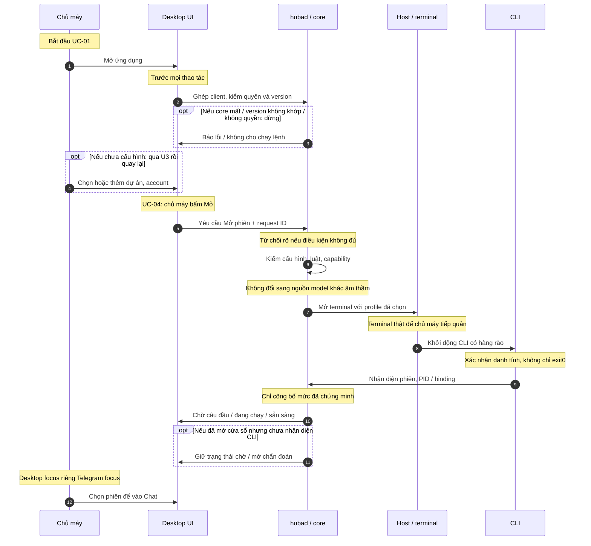
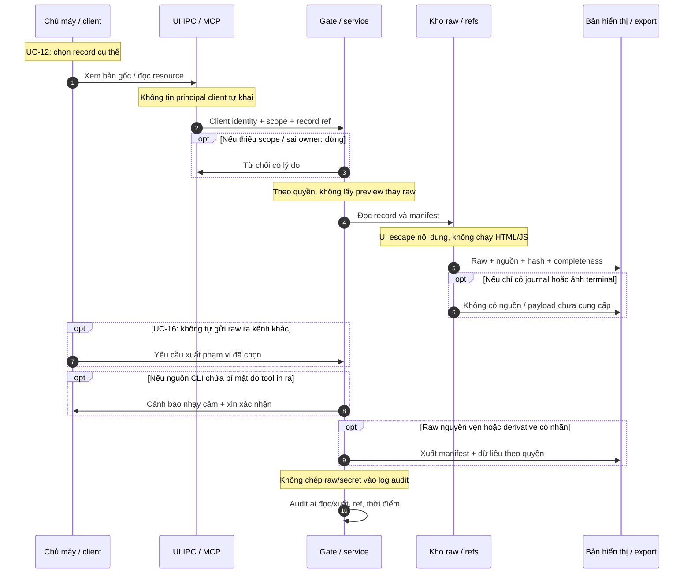
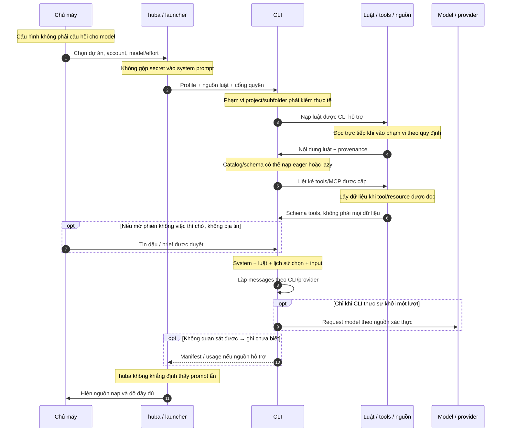
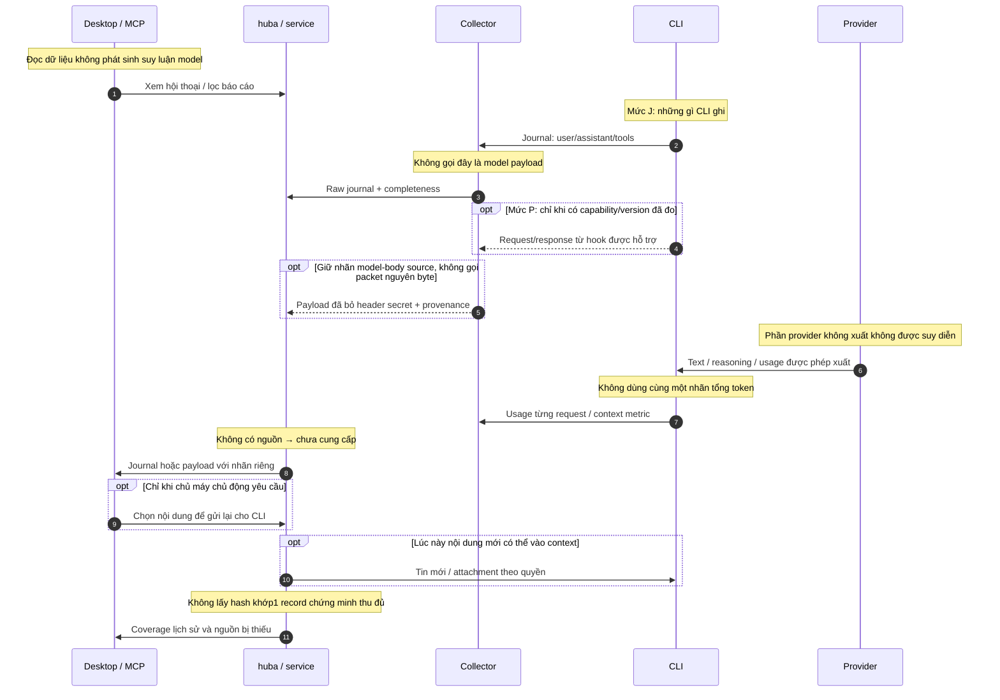

# huba — Luồng UC · dữ liệu · context / input / output

BẢN THIẾT KẾ ĐỂ DUYỆT. Các service/collector/kho raw/transport desktop trong bản này là đề xuất, chưa triển khai và chưa nghiệm thu trên ứng dụng thật.

huba là cầu nối tới phiên CLI thật. Chủ máy thao tác qua Desktop, Telegram hoặc terminal; CLI vẫn sở hữu vòng gọi model và lắp context. huba chuyển lệnh, kiểm nhận, thu nguồn được CLI cung cấp và trình bày lại — không tạo thêm một agent suy luận đứng giữa.

## Quy tắc đọc
- Ba lớp dùng chung ID để lần từ UC → command → phiên/lượt → request model → raw record → nội dung hiển thị. ID không có từ nguồn phải để chưa xác định, không ghép bằng thời gian gần nhau.
- Đọc sơ đồ từ trên xuống. Hàng vàng/hồng/tím là nhánh có điều kiện, không phải mọi hàng đều chạy nối tiếp; UC có thể dừng ở nhánh lỗi. Mũi tên chỉ bên gửi → bên nhận, không biểu thị thời gian đo thực tế.
- Desktop và Telegram gọi cùng nghiệp vụ tại hubad; terminal đi thẳng CLI rồi collector quan sát lại. Không có poller Telegram thứ hai, không đẩy mọi sự kiện về mọi kênh nếu chưa được chọn theo dõi.
- Ba thứ khác nhau: chữ người dùng nhập; nhật ký CLI ghi; payload request/response thực gửi tới model. Bản gốc phải mang đúng nhãn nguồn và độ đầy đủ.
- Context model ≠ lịch sử đang hiển thị trên UI ≠ kho raw ≠ tổng token sử dụng. Mở màn/xem raw/lọc báo cáo không tự gọi model hoặc nạp lại prompt.
- Hàng rào quyền chạy ở core và lớp thực thi, không dựa vào model nhớ lời dặn. Nội dung model/tool/raw luôn được coi là dữ liệu không đáng tin khi render; không chạy HTML/JS hay lệnh do nó chứa.
- Chuẩn thiết kế mong muốn có thể chặt hơn mã hiện tại. Nguồn hiện có và khoảng chưa chứng minh được ghi cuối trang; đây không phải bản đồ phụ thuộc máy trích từ code/traces.

## Danh mục UC
| UC | Người dùng / mục tiêu | Input | Output nhìn thấy | Sơ đồ | Điều kiện lỗi / nghiệm thu dự kiến |
| --- | --- | --- | --- | --- | --- |
| UC-01 | Chủ máy mở app / kết nối dịch vụ | Danh tính OS, bản app/core, workspace | Vào màn chính hoặc lỗi đúng bước | U1, D2 | Core lệch phiên bản, không quyền, probe lỗi không được biến thành danh sách rỗng |
| UC-02 | Chọn / thêm dự án | Folder thật, cấu hình mặc định, revision | Dự án đã lưu; luật được nhận diện | U3, C1 | Folder mất/quyền thiếu → không lưu thành sẵn sàng; không tự mở rộng quyền ghi |
| UC-03 | Thêm account / đăng nhập / đổi model | CLI, account, model, lần login | Trạng thái xác thực và phạm vi áp dụng | U3, C1 | Mã hết hạn/lần login cũ không được gửi sang cửa sổ khác; khóa account không xóa lịch sử |
| UC-04 | Mở phiên | Dự án, account hoặc auto, model/effort, việc tùy chọn | Phiên CLI có ID và terminal thật | U1, C1 | Mở được pane chưa phải CLI sẵn sàng; thiếu luật/quyền phải có trạng thái rõ |
| UC-05 | Gửi tin / nhận phản hồi | Nội dung, attachment refs, session ID, command ID | Đã nhận / chưa xác định / phản hồi nguồn | U2, D2, C2 | Double-click/mất ACK không được gõ lại mù; attachment chưa đọc không được nhận đã gửi đủ |
| UC-06 | Trả lời bảng hỏi nhiều câu | Question ID/revision, các đáp án | CLI ghi nhận lựa chọn, tiếp tục lượt | U2, D2 | Câu hỏi đổi, phiên chết, thiếu đáp án → làm mới/giữ lựa chọn, không bấm bảng cũ |
| UC-07 | Xem hoạt động tool / subagent | Phiên, lượt, tool-call ID, parent-child refs | Hoạt động đang chạy/kết quả/lỗi có nguồn | D1, C2 | Tool lỗi hoặc child chưa kết thúc không được hiện hoàn thành; không gộp output child thành parent gốc |
| UC-08 | Ngắt lượt | Phiên đích, xác nhận, capability | Lượt bị ngắt, phiên còn sống | U2, C2 | Đợi bằng chứng kết thúc/ngắt; không đồng nghĩa giết mọi process do tool đã mở |
| UC-09 | Đóng phiên / đóng cửa sổ app | Đích thao tác và xác nhận | Phiên đóng hoặc app ẩn, tác động được ghi rõ | U2, U4 | Đóng app không mặc định tắt hubad/CLI; không đóng nhầm tty đã tái sử dụng |
| UC-10 | Resume / fork hỏi / bàn giao | Nguồn, đích, checkpoint và capability | Liên kết phiên hoặc nhánh phụ rõ ràng | U4, C3 | Không hỗ trợ thì từ chối đúng nghĩa; không chuyển tài khoản/CLI như thể context nguyên vẹn |
| UC-11 | Kết nối / dùng Telegram | Bot, owner chat, scope theo dõi, lệnh | Nhận/gửi hai chiều qua cùng core | U3, D2 | Sai chat bị từ chối; getMe thành công chưa chứng minh giao tiếp hai chiều |
| UC-12 | Xem nội dung gốc / truy cập MCP | Record ref, client identity, scope | Nguồn đúng loại + coverage + raw theo quyền | D3, C4 | Không có payload thì hiện không cung cấp; MCP không tự nghe toàn bộ giao tiếp model |
| UC-13 | Xem báo cáo token / CSV | Khoảng ngày/múi giờ/account/model/dự án | KPI/chart/bảng/CSV cùng phạm vi | D4, C4 | Usage thiếu không thành0; stream/final, parent-child và cache không cộng đôi |
| UC-14 | Mất kết nối / restart / đọc lịch sử | Cursor, command đang treo, revision | Draft giữ nguyên; khôi phục trạng thái có bằng chứng | U4, D1, D2 | Không tự gửi lại command đã có khả năng thực thi; cursor mất → báo gap, không giả liên tục |
| UC-15 | Sửa cấu hình / quyền | Giá trị mới, expected revision, actor | Revision + audit + thời điểm áp dụng | U3, C1 | Xung đột revision → đối chiếu lại, không ghi đè; model không được tự cấp quyền |
| UC-16 | Xuất dữ liệu / chẩn đoán | Phạm vi, quyền xuất, xác nhận chủ máy | Manifest export và nhãn raw/derivative | D3, D4 | Không tự phát tán raw nhạy cảm; secret transport của huba không vào log hay bản chẩn đoán |

## Thành phần tham gia một phiên — ai làm việc gì?

Đây là các vai trò logic; không đồng nghĩa mỗi vai trò phải là một tiến trình/dịch vụ. Nhiều vai trò nằm chung hubad hoặc CLI. Thành phần tùy chọn chỉ tham gia khi UC/capability cần; không bắt một tin chào đi qua mọi thành phần.

| Mã | Thành phần | Input → output / trách nhiệm | Tham gia khi nào |
| --- | --- | --- | --- |
| A01 | Chủ máy | Mục tiêu, câu hỏi, xác nhận, tệp → ý định thao tác | Mọi UC; không thay quyết định người dùng bằng model đoán |
| A02 | Khung chat Desktop | Draft + session đích → send/answer/action; event → timeline | Chat local; draft/UI state không tự vào model |
| A03 | Telegram client + adapter | Owner text/callback/file → route/command; event → tin/nút | Kênh tùy chọn; một collector Telegram; gate chat/user đúng loại update |
| A04 | Terminal / TUI | Gõ trực tiếp → CLI; CLI → chữ màn hình/PTY | Chủ máy tiếp quản phiên thật; không bắt gõ terminal phải vòng qua huba |
| A05 | Vỏ Desktop / IPC client | UI command → local transport đã ghép; stream → UI | Đề xuất Tauri; không cho frontend chạy shell/đọc DB CLI tùy ý |
| A06 | Gate danh tính và scope | OS peer/pairing hoặc owner chat → quyền thao tác | Mọi cửa core; không tin actor/scope client tự khai |
| A07 | Router / application service | Phân loại quản lý hay chat → handler chung | help/list/config có thể dừng tại huba, không đi model |
| A08 | Sổ command + dispatcher | Intent/command ID → trạng thái và delivery attempt | Lệnh có side effect; idempotency và hòa giải sau crash |
| A09 | Config / account / project service | Revision + defaults + secret refs → cấu hình đã kiểm | Mở phiên, đổi cấu hình; không model inference |
| A10 | Session driver + binding | Command + target identity → thao tác CLI có kiểm nhận | Gửi, ngắt, chọn câu hỏi, đóng, resume nếu hỗ trợ |
| A11 | Host / OS adapter | Yêu cầu tiến trình/terminal → PID/TTY/pane/cửa sổ | Linux/macOS/Windows có backend riêng; không resize phiên sống |
| A12 | CLI runtime Claude / OpenCode / nguồn đã hỗ trợ | User messages + config → agent loop, journal, model calls | Chủ sở hữu phiên và semantics context; không phải huba tự dựng agent loop |
| A13 | Context builder của CLI | Luật + lịch sử chọn + input + tools + results → request | Mỗi request, kể cả request tiếp sau tool; prompt có thể bị runtime biến đổi |
| A14 | Provider adapter / SDK / auth transport | Messages/tools/settings + auth riêng → request; stream → event | Gọi đúng provider; auth header không phải prompt; adapter có thể đổi serialization |
| A15 | Model/provider | Request model → text/tool-call/usage/stop hoặc lỗi | Chỉ khi có inference; phần system/thinking không xuất thì không bịa |
| A16 | Tool coordinator + gate thực thi | Tool-call ID/args → kiểm quyền → tool result/error | Nếu model yêu cầu tool; tool-call mới là yêu cầu, chưa phải đã chạy |
| A17 | Tool native / shell / file / plugin | Args + quyền → nội dung/ref/side effect/error | Tool built-in không cần qua MCP; output có thể quay lại context |
| A18 | MCP client phía CLI | Tool-call/resource request → MCP protocol → result | Chỉ tool/resource dùng MCP; không phải mọi câu chat đều qua MCP |
| A19 | MCP server công cụ | RPC tool/resource + quyền → đọc/ghi hệ thống nguồn → result | Ví dụ project-agent; server còn phải gate quyền nghiệp vụ, không chỉ client |
| A20 | Nguồn dữ liệu/tool đích | File, code repo, DB, API, bộ nhớ → dữ liệu hoặc side effect | Theo tool; nguồn ngoài có thể có auth riêng, lỗi/timeout/rate-limit |
| A21 | Subagent runtime | Task được giao + context con chọn → kết quả con | Tùy CLI; phiên con và usage riêng; không mặc định share toàn context cha |
| A22 | Journal / DB / hook chính thức của CLI | Hoạt động runtime → bản ghi nguồn có schema/version | Nguồn quan sát; không mặc định là wire payload model |
| A23 | Plugin / collector của huba | Nguồn CLI + cursor → raw observation + gap/error | Không gọi model để trích xuất; capture payload chỉ ở hook được hỗ trợ |
| A24 | Raw store + cursor / provenance | Record nguồn → dữ liệu nguyên theo nguồn + hash/checkpoint | Đề xuất mới; quyền riêng/retention; không ghi ngược DB CLI để giả event |
| A25 | Normalizer / projection / event delivery | Raw → timeline/tool/status, event IDs/read cursors | Đề xuất service chung; UI/Telegram/MCP đọc cùng semantics |
| A26 | Usage normalizer + local report index | Raw usage → canonical request usage/coverage | Báo cáo token; không billing/tracker hay model phân tích mới |
| A27 | Output renderer / attachment viewer | Event/blocks/ref → chữ, code, tệp, trạng thái, nguồn | Không thực thi HTML/JS/lệnh từ model; preview cắt phải có nhãn |
| A28 | MCP facade của huba | Client đã cấp scope → đọc nguồn/thống kê hoặc command được phép | Cửa tùy chọn mới; khác MCP server công cụ A19. Không cần đi qua facade để vẽ UI |
| A29 | Secret store / env + audit | Secret name/ref → transport credential; action → audit ref | Cắt ngang các lớp; log key names, không chép credential vào prompt/diagnostics |
| A30 | Nguồn luật/memory/compaction của CLI | Tệp luật, memory được đọc, summary → phần context | Chỉ phần thực sự nạp; raw history/UI history không tự thành context |

## Dữ liệu nào qua chat, MCP, model, lưu và hiển thị?

Có điều kiện nghĩa là phải có thao tác/capability được nêu; không mặc định toàn bộ dữ liệu đi qua model. MCP công cụ = A18/A19; MCP huba = A28. Tài liệu này không coi MCP là đường dây của mọi giao tiếp.

| Dữ liệu | Đường đi | Qua MCP? | Vào model context? | Lưu / đầu ra |
| --- | --- | --- | --- | --- |
| Tin chat mới | Khung chat/Telegram → gate/core → driver → CLI → context builder → provider/model | Không bắt buộc | Có, sau CLI nhận và thực đưa vào request | Intent/ACK tại huba; input journal/raw theo nguồn; timeline |
| help / danh sách phiên / đổi filter | UI/Telegram → router/query huba → kết quả | Chỉ nếu client chọn gọi facade | Không cần | UI/ack; không thêm lượt model |
| Draft chưa gửi | Khung chat → bộ nhớ/local draft theo thiết kế | Không | Không | Draft theo phiên; không gọi đã gửi |
| Luật workspace/project | Nguồn tệp → CLI nạp/đọc → context builder | Không bắt buộc; có thể qua Read native | Có nếu nạp/đọc vào context | Refs/hash/manifest nếu quan sát được; không bịa auto-load |
| Schema tool/MCP catalog | Tool registry/MCP server → CLI expose tools → model | Discovery có thể qua MCP | Có thể chiếm token khi expose; lazy/eager tùy CLI | Catalog/capability theo phiên bản; không phải toàn DB |
| Model tool-call | Model → provider adapter → CLI tool coordinator | Chỉ nếu tool đó ánh xạ MCP | Là output request hiện tại; có thể thành lịch sử input sau | Tool-call ID, args, permission state; chưa coi đã thực thi |
| Native tool args/result | CLI → quyền → native tool → file/shell → CLI | Không | Result có thể vào request tiếp; không tự hết mọi byte | Raw tool result/ref + preview/truncation có nhãn |
| MCP tool args | CLI MCP client → server → handler → data source | Có, MCP công cụ | Args là output model hoặc request do client tạo | Tool trace theo quyền, không log credential transport |
| MCP tool result | Nguồn → MCP server → client → CLI → context builder | Có, MCP công cụ | Có nếu CLI chọn đưa vào request tiếp | Structured/text/content refs; giữ lỗi/isError khi nguồn có |
| Đọc MCP resource bởi app/client | Client → MCP facade huba → scope gate → raw/projection → client | Có, MCP huba | Không mặc định; chỉ khi client đó đưa kết quả vào model | Đọc theo cursor; cùng provenance, audit theo quyền |
| Raw output của tool quá dài | Tool → CLI representation → request tiếp | Tùy loại tool | Có thể chỉ phần trim/ref; raw không đồng nghĩa model đã đọc hết | Bản nguồn và derivative riêng; đánh dấu phần bị cắt |
| Tệp/ảnh người dùng gửi | UI/Telegram → attachment resolver → CLI → provider nếu hỗ trợ | Không bắt buộc | Có điều kiện: byte ảnh/text/ref theo khả năng CLI/provider | Manifest/path/hash theo nguồn; có path chưa phải có byte |
| Text assistant cuối | Model → CLI → journal/event → collector → projection → UI/kênh | Không cần; facade có thể cho đọc lại | Là output; có thể vào lịch sử input lượt sau | Content blocks, nguồn, finish/turn state; không chỉ một chuỗi text |
| Reasoning/thinking | Provider → CLI nếu được xuất → collector | Không tự có nhờ MCP | Có thể là runtime opaque/reasoning; không hứa được xem | Chỉ trường nguồn cung cấp; ẩn/không xuất phải ghi rõ |
| Usage token | CLI/provider event → collector → normalizer → report index | Facade có thể cho đọc theo quyền | Không cần gửi model để tính báo cáo | Input/output/cache/semantics/coverage; unknown không thành0 |
| Context-window metric | CLI khai → huba display | Không bắt buộc | Metadata không tự là prompt | Tách tổng usage; không dùng bảng đoán làm số thật |
| Journal CLI / model payload | Nguồn chính thức → collector → raw/projection | Facade đọc lại tùy quyền | Không tự gửi lại model; chúng mô tả input/output đã xảy ra | Hai source kinds khác nhau; payload chỉ nếu hook hỗ trợ |
| Màn hình terminal | Host/PTY capture → snapshot → UI/Telegram | Không bắt buộc | Không mặc định; gửi ảnh lại là UC khác | Nguồn màn hình, không gọi transcript/payload nguyên bản |
| Account/model/config update | Admin UI → core revision/audit → profile mới | Có thể nếu facade có tool quản trị được cấp | Không inference; setting ảnh hưởng request sau đúng phạm vi | Config giữ tên secret; khóa không xóa lịch sử |
| Credential/token provider hoặc MCP | Secret store/env → auth transport | Có thể dùng để auth MCP, không nằm tool args | KHÔNG chủ động đưa vào context | Không trong code/prompt/log/CSV; key names hoặc secret refs |
| Lỗi/gate từ chối/permission hỏi | Gate/CLI/tool → sự kiện → UI → chủ máy quyết | Tùy lỗi thuộc MCP hay native | CLI có thể đưa tool error vào request sau | Giữ loại lỗi và trạng thái, không báo thành công/rỗng |
| Brief/handover | Nguồn chọn → checkpoint/summary → chủ máy duyệt → phiên mới | Không bắt buộc | Có khi chủ máy chuyển brief; tóm tắt bằng model phát sinh usage | Predecessor + source refs; không gọi là chép nguyên context |

## X0 · Trọn một tương tác — khung chat, MCP, model và kết quả

Sơ đồ tổng nối đủ các nhóm thành phần của một lượt giả định có tool MCP. Đây là một kịch bản, không buộc mọi lượt phải gọi MCP. Sơ đồ rộng: kéo ngang; các sơ đồ U/D/C sau phóng riêng từng vòng.

```mermaid
sequenceDiagram
    autonumber
    participant P0 as Chủ máy / chat
    participant P1 as huba core / driver
    participant P2 as CLI / context
    participant P3 as Provider / model
    participant P4 as Tool runner / MCP client
    participant P5 as MCP tool server
    participant P6 as File / DB / API
    participant P7 as Plugin / collector
    participant P8 as Raw / index / usage
    participant P9 as UI kết quả / kênh
    participant P10 as MCP facade huba
    Note over P0: 01 · Khung chat gửi; quản lý thuần túy có thể dừng tại huba
    P0->>P1: Input + session ref + command ID
    Note over P1: 02 · Không chuyển input sang model bằng một agent trung gian
    P1->>P1: Gate quyền, ghi intent, khóa đúng phiên
    Note over P1: 03 · CLI-accepted khác huba-received
    P1->>P2: Giao chữ/tệp theo capability và kiểm nhận
    Note over P2: 04 · Context builder của CLI lắp request
    P2->>P2: Luật + lịch sử chọn + schemas + input
    Note over P2: 05 · Provider adapter serialize; phần ẩn chỉ provider biết
    P2->>P3: R1: request model /  auth ngoài prompt
    opt 06 · Đường quan sát song song; chưa chắc là wire payload
    P2-->>P7: Journal/event R1 nếu nguồn xuất
    end
    opt 07 · Model đề nghị gọi tool, chưa có kết quả dữ liệu
    P3->>P2: Output R1: tool-call ID + tên + args
    end
    opt 08 · Nếu tool là MCP; native tool đi thẳng tool native
    P2->>P4: Tool-call qua gate/permission
    end
    opt 09 · MCP client/server, không qua khung chat như tin người dùng
    P4->>P5: MCP request tool + arguments
    end
    opt 10 · MCP tool có thể đọc/ghi; side effect cần quyền đúng UC
    P5->>P6: Handler kiểm quyền rồi đọc nguồn
    end
    opt 11 · Nguồn trả kết quả, không trả system prompt mới
    P6->>P5: Dữ liệu / error / ref attachment
    end
    opt 12 · Server trả protocol result cho client
    P5->>P4: MCP result: content/structured/error
    end
    opt 13 · CLI nhận trước; giữ error/truncation metadata
    P4->>P2: Tool result + tool-call ID
    end
    opt 14 · Collector thu phần CLI thực sự xuất
    P2-->>P7: Nguồn tool-call/result/permission
    end
    opt 15 · Một lượt chat có thể có nhiều request model
    P2->>P2: Lắp context R2 có result được chọn
    end
    opt 16 · Không gửi mọi DB/raw/history của huba tự động
    P2->>P3: R2: context cập nhật + tool result
    end
    Note over P3: 17 · Reasoning/tệp chỉ khi nguồn cung cấp
    P3->>P2: Final text/blocks + usage/stop nếu có
    Note over P2: 18 · Thu journal hoặc hook chính thức theo schema
    P2->>P7: Assistant event + turn state + usage
    Note over P7: 19 · Source kind / IDs / completeness; không cộng stream-final đôi
    P7->>P8: Lưu raw+cursor /  projection /  canonical usage
    Note over P8: 20 · UI/kênh theo dõi nhận cùng semantics
    P8->>P9: Timeline, tool trace, state, usage, refs
    Note over P9: 21 · Đọc không gọi model và không tự gửi vào context
    P9->>P0: Xem phản hồi, tool, tệp, lỗi, nguồn
    opt 22 · Nhánh riêng: chỉ khi dùng MCP facade
    P0-->>P10: Client có quyền đọc resource huba
    end
    opt 23 · Facade là cửa truy cập kho huba, không phải tool server bắt buộc
    P10-->>P8: Gate scopes /  query raw/projection/usage
    end
    opt 24 · Không cần model cho thao tác đọc
    P8-->>P10: Resource/page theo cursor + provenance
    end
    opt 25 · MCP không tự nạp mọi dữ liệu vào prompt
    P10-->>P0: Trả client /  chỉ vào model nếu client chọn
    end
```

**Input:** Chủ máy gửi một yêu cầu cần đọc dữ liệu; phiên/profile/model đã được kiểm. Không dùng dữ liệu thật trong ví dụ thiết kế.

**Output:** Kết quả gồm nội dung assistant, khối code/tệp nếu nguồn có, tool trace, trạng thái giao/lượt, usage/context metrics và provenance/coverage — không hứa phần provider không xuất.

**Ràng buộc:** Model không trực tiếp truy cập DB hoặc thực thi MCP. CLI điều phối tool; MCP server thực thi handler theo quyền; dữ liệu tool quay về CLI trước khi có thể trở thành input request kế. Collector là đường quan sát song song, không phải model thứ hai.

## U1 · Mở app → chọn dự án → mở phiên thật

Đường vào chính, có cả máy đã cài và lần đầu. Có thể mở phiên chưa nhập việc; huba không tạo phiên headless thay thế một cách âm thầm.



**Input:** OS user, phiên bản app/core, workspace/project ref, account ref hoặc auto, model/effort, việc tùy chọn.

**Output:** Session ref + terminal binding có bằng chứng; UI hiển thị sẵn sàng hoặc trạng thái chưa xác định/lỗi đúng bước.

**Ràng buộc:** Danh sách không đọc được khác danh sách0 phiên. Pane mở được khác CLI sẵn sàng. Chưa có câu đầu thì ghi chờ câu đầu, không bịa phản hồi.

## U2 · Chat → hỏi đáp → ngắt lượt / đóng phiên

Một lượt người dùng, từ draft tới phản hồi. Các thao tác hỏi, ngắt, đóng là nhánh độc lập có kiểm trạng thái, không phải tự động chạy sau mỗi tin.

```mermaid
sequenceDiagram
    autonumber
    participant P0 as Chủ máy
    participant P1 as UI / Telegram
    participant P2 as hubad / core
    participant P3 as CLI / nguồn sự kiện
    Note over P0: Draft thuộc đúng phiên
    P0->>P1: Chọn phiên /  soạn tin
    Note over P1: Chủ máy bấm Gửi
    P1->>P2: Gửi command ID + nội dung
    Note over P2: Chưa tác động CLI trước khi ghi nhận
    P2->>P2: Ghi ý định bền vững + kiểm quyền
    Note over P2: Đường driver có kiểm nhận — D2
    P2->>P3: Giao lệnh tới đúng phiên
    opt Nếu thiếu bằng chứng nhận: không tự gửi lại
    P2->>P1: Còn trong ô / chưa xác định
    end
    opt Nếu có bằng chứng khớp command
    P3->>P2: Nguồn ghi nhận input, tiến trình
    end
    Note over P2: ACK giao khác kết thúc lượt
    P2->>P1: CLI đã nhận /  vẽ hoạt động
    opt Nếu CLI yêu cầu lựa chọn
    P3->>P2: Câu hỏi + revision theo nguồn
    end
    opt Kênh theo dõi nhận cùng revision
    P2->>P1: Hiện bảng hỏi đúng phiên
    end
    opt Nếu bảng còn đúng revision
    P0->>P2: Trả đủ đáp án qua UI
    end
    opt Nếu adapter hỗ trợ và đúng phiên
    P2->>P3: Gửi lựa chọn /  đọc lại kết quả
    end
    Note over P3: Output theo D1, vòng model theo C2
    P3->>P2: Phản hồi / lỗi + nguồn
    Note over P2: Renderer không thực thi nội dung model
    P2->>P1: Timeline và trạng thái lượt
    opt Chỉ khi chủ máy bấm Ngắt và có capability
    P0->>P2: Ngắt lượt qua UI
    end
    opt Giữ phiên; báo riêng tác vụ nền còn lại
    P2->>P3: Ngắt /  xác minh lượt đã dừng
    end
    opt Chỉ khi chủ máy chọn Đóng phiên
    P0->>P2: Đóng phiên qua UI + xác nhận
    end
    opt Không đóng nhầm terminal tái sử dụng
    P2->>P3: Kiểm identity, đóng, đọc lại
    end
    opt Không biến timeout thành đã đóng
    P2->>P1: Đã đóng hoặc chưa đo được
    end
```

**Input:** Đúng session ID, draft, attachment refs nếu hỗ trợ; question revision khi trả lời; xác nhận cho thao tác phá dở.

**Output:** Trạng thái giao lệnh tách khỏi trạng thái lượt model; phản hồi và hoạt động có nguồn; giữ draft khi chưa giao.

**Ràng buộc:** Không gọi đã gửi chỉ vì gõ chữ hoặc Enter trả0. Không retry mù. Đóng phiên không đồng nghĩa ngắt lượt; tool nền có thể còn sống phải được báo.

## U3 · Dự án · account/model · cấu hình · Telegram

Bốn nhánh thiết lập do chủ máy chủ động chọn. Cùng quyền quản trị và revision/audit; không mặc định nối Telegram để được chat local.

```mermaid
sequenceDiagram
    autonumber
    participant P0 as Chủ máy / UI
    participant P1 as hubad / config
    participant P2 as Host / secret store
    participant P3 as CLI login
    participant P4 as Telegram
    opt Nhánh UC-02: thiết lập dự án
    P0->>P1: Chọn folder + mặc định dự án
    end
    opt Nếu thiếu quyền: báo lỗi; không tự nới
    P1->>P2: Kiểm folder, quyền, nguồn luật
    end
    opt Nhánh UC-03: quản lý account
    P0->>P1: Thêm account, model, CLI
    end
    opt Chủ máy bấm Đăng nhập
    P1->>P3: Mở login gắn account + attempt ID
    end
    opt Không trộn lần login hoặc cửa sổ
    P3->>P0: URL / mã / xác thực cần người dùng
    end
    opt Hết hạn / hủy / lỗi phải tách sẵn sàng
    P3->>P1: Kết quả xác thực theo nguồn
    end
    opt Nhánh UC-15: quyền quản trị đã kiểm
    P0->>P1: Lưu config + expected revision
    end
    opt Không đặt secret trong audit/prompt
    P1->>P2: Lưu secret riêng /  config giữ tên
    end
    opt Xung đột → so diff, không ghi đè
    P1->>P0: Revision + audit + phạm vi áp dụng
    end
    opt Nhánh UC-11: tùy chọn
    P0->>P1: Bật wizard Telegram
    end
    opt Dùng cùng collector, không poll đôi
    P1->>P4: Kiểm bot /  xác minh owner chat
    end
    opt Cần thao tác chủ máy hai chiều
    P0->>P4: Nhắn bot /  bấm kiểm gửi/nhận
    end
    opt Sai chat/token/mạng là lỗi riêng
    P4->>P1: Ghi kết quả và scope theo dõi
    end
    opt Không nhận getMe là nghiệm thu hai chiều
    P1->>P0: Kết nối hoặc lỗi đúng bước
    end
```

**Input:** Folder, loại CLI, model/account config, credential qua luồng riêng, bot/owner-chat config, expected revision.

**Output:** Cấu hình có version/audit; account xác thực hoặc lỗi cụ thể; Telegram kiểm hai chiều; biết thay đổi áp dụng lúc nào.

**Ràng buộc:** Secret chỉ ở kho secret/env; UI không đọc trả token đã lưu. Khóa account không xóa lịch sử. Không đổi model phiên sống nếu chưa có khả năng đã đo.

## U4 · Mất kết nối · resume · fork · bàn giao

Phục hồi việc đang làm mà không gửi trùng, không làm chủ máy hiểu nhầm context được chuyển nguyên vẹn giữa các CLI/account.

```mermaid
sequenceDiagram
    autonumber
    participant P0 as Chủ máy / UI
    participant P1 as hubad / core
    participant P2 as CLI / host
    participant P3 as Kho cục bộ
    opt Nếu mất kết nối
    P0->>P0: Giữ draft, đánh dấu dữ liệu cũ
    end
    opt Khi kết nối phục hồi
    P0->>P1: Ghép lại + cursor + command IDs
    end
    opt Đối chiếu trạng thái trước gửi lại
    P1->>P3: Đọc lệnh treo và mốc nguồn
    end
    opt Không gõ lại chỉ vì mất ACK
    P1->>P2: Thăm dò danh tính và bằng chứng
    end
    opt Thiếu bằng chứng giữ chưa xác định
    P1->>P0: Đã nhận / còn chờ / chưa xác định
    end
    opt Nhánh Resume: chủ máy chọn
    P0->>P1: Tiếp tục phiên cùng CLI/profile
    end
    opt Khôi phục theo CLI, không từ UI buffer
    P1->>P2: Resume chính thức nếu hỗ trợ
    end
    opt Nhánh Fork: nếu capability đã đo
    P0-->>P1: Hỏi nhánh chỉ đọc
    end
    opt Không chèn câu hỏi vào phiên gốc
    P1-->>P2: Fork ID mới, quyền chỉ đọc
    end
    opt Nhánh Handover: chủ máy chọn
    P0->>P1: Bàn giao: xem đích và checkpoint
    end
    opt Nếu cần model tóm tắt phải báo có gọi model
    P1->>P3: Lưu brief + refs + phần chưa biết
    end
    opt Có quan hệ predecessor, không hứa chép toàn context
    P1->>P2: Mở đích với brief được duyệt
    end
    opt Thiếu capability → báo chưa hỗ trợ
    P1->>P0: Kiểm đích rồi mới đề nghị đóng gốc
    end
    opt Nhánh Đóng app; không phải Đóng phiên
    P0->>P0: Đóng cửa sổ app, để dịch vụ chạy
    end
```

**Input:** Session ref, command treo, cursor đọc, draft, capability và checkpoint/brief nếu bàn giao.

**Output:** Tiếp tục đọc hoặc làm việc với đúng danh tính; nhánh fork/checkpoint có provenance; trạng thái mơ hồ không bị che.

**Ràng buộc:** Không replay tác dụng phụ đã có thể xảy ra. Mở app lại không tự mở CLI mới. Brief là bản tóm tắt dẫn nguồn, không phải toàn bộ context gốc.

## D1 · Nguồn CLI → raw → projection → màn hình

Đường dữ liệu quan sát một chiều. Collector không phải tác nhân model và không ghi ngược vào kho CLI để giả sự kiện.

```mermaid
sequenceDiagram
    autonumber
    participant P0 as Nguồn CLI
    participant P1 as Collector / adapter
    participant P2 as Kho raw + cursor
    participant P3 as Projection / index
    participant P4 as UI / kênh đã chọn
    Note over P0: Journal/file hoặc DB snapshot được hỗ trợ
    P0->>P1: Record + vị trí nguồn + version
    Note over P1: Nguồn lỗi → log và coverage gap
    P1->>P1: Kiểm generation, identity, schema
    Note over P1: Commit nguyên tử với ingest checkpoint
    P1->>P2: Ghi bản gốc + hash + source ref
    Note over P2: Chỉ sau commit mới nâng cursor nguồn
    P2->>P1: Mốc ingest đã bền vững
    Note over P1: Worker phục hồi được từ raw chưa xử lý
    P1->>P3: Chuẩn hóa bằng raw ref
    opt Nếu schema lạ/hỏng; không nuốt thành rỗng
    P1->>P3: Parse-error event + raw ref
    end
    Note over P3: ID nguồn + thế hệ; không chỉ timestamp
    P3->>P3: Khử trùng và liên kết chắc chắn
    Note over P3: Cập nhật màn, không gọi model
    P3->>P4: Event/timeline + read cursor
    opt Nếu reconnect; replay đọc không có side effect
    P4->>P3: Đọc tiếp bằng cursor
    end
    opt Nếu cursor đã hết hạn hoặc nguồn thiếu
    P3->>P4: Gap / dữ liệu cũ / cần snapshot
    end
    opt Nếu nguồn có liên hệ chứng minh được
    P0->>P1: Stream và final cùng request ref
    end
    opt Không tạo hai câu trả lời final trùng
    P3->>P4: Một message cập nhật, raw vẫn giữ
    end
```

**Input:** Sự kiện/journal/DB chính thức có schema/version; màn hình là nguồn tách riêng; payload chỉ khi điểm mở rộng hỗ trợ.

**Output:** Raw ref bất biến theo nguồn, cursor bền vững, event chuẩn hóa, timeline/hoạt động có completeness.

**Ràng buộc:** Lưu raw/parse error trước khi nâng cursor. Không có ID chắc chắn thì không ghép; không xóa record hỏng rồi nhận đã thu đủ. Truy cập nguồn phải theo quyền.

## D2 · Input người dùng → command → kiểm nhận

Tách chính xác huba nhận yêu cầu, CLI nhận chữ và model xử lý. Đây là đường ghi duy nhất cho thao tác từ các kênh được cấp quyền.

```mermaid
sequenceDiagram
    autonumber
    participant P0 as Desktop / Telegram
    participant P1 as Gate / core
    participant P2 as Sổ command
    participant P3 as Session driver
    participant P4 as CLI / journal
    Note over P0: Desktop qua IPC; Telegram qua owner-chat gate
    P0->>P1: Identity + input + command ID
    opt Nếu sai quyền / sai phiên / revision cũ: dừng
    P1->>P0: Từ chối + audit lý do
    end
    Note over P1: Trước side effect; không dùng text hash duy nhất
    P1->>P2: Insert intent theo idempotency key
    opt Nếu retry cùng key, đúng principal/phạm vi
    P2->>P0: Trả trạng thái lệnh đã có
    end
    Note over P2: Chỉ một writer/lease gửi trên mỗi phiên
    P2->>P3: Lệnh mới + target generation
    Note over P3: Revalidate identity ngay trước side effect
    P3->>P4: Thực hiện một lần có kiểm nhận
    Note over P4: Nguồn bằng chứng được adapter hỗ trợ
    P4->>P3: Input record / composer / lỗi
    opt Khi bằng chứng đủ
    P3->>P2: CLI-accepted / in-composer / failed
    end
    opt Nếu crash, mất ACK hoặc không đọc được nguồn
    P3->>P2: Uncertain + attempt evidence
    end
    Note over P2: Không lấy exit0 làm accepted
    P2->>P0: Trạng thái giao thật
    opt Sau restart: không tự replay hành động mơ hồ
    P1->>P4: Chỉ đọc để hòa giải lệnh treo
    end
    Note over P4: CLI-accepted khác model-done
    P4->>P1: Turn events qua collector D1
    Note over P1: Đúng kênh và đúng phiên được theo dõi
    P1->>P0: Cập nhật output + trạng thái
```

**Input:** Principal được transport xác minh, channel/source-message ID, session ref, client command ID, expected revision, nội dung.

**Output:** Sổ lệnh/attempt và kết quả giao có bằng chứng. Request model chỉ xuất hiện ở C2 khi CLI thực sự gọi.

**Ràng buộc:** Terminal nhập trực tiếp không có command huba thì không bịa command ID. Một command có nhiều delivery attempt được ghi riêng, không có nghĩa được thực thi nhiều lần.

## D3 · Xem raw · MCP facade · xuất dữ liệu

Đọc cùng nguồn từ desktop hoặc MCP mà không ngầm gọi model. Nếu model tự gọi MCP tool thì response có thể đi vào context của đúng lượt đó — xem C2.



**Input:** Client/principal, scopes, record refs hoặc cursor; yêu cầu export riêng và xác nhận khi nhạy cảm.

**Output:** Nội dung đúng loại nguồn, manifest/provenance/coverage; derivative đã lọc có nhãn khác raw.

**Ràng buộc:** MCP là cửa đọc/điều khiển có quyền, không phải bộ bắt toàn bộ I/O. Secret transport cấu hình không được đưa vào response. Chủ máy vẫn xem raw nhạy cảm theo quyền.

## D4 · Usage CLI/plugin → thống kê token

Dữ liệu token đi cùng raw/provenance, không qua một lời gọi model phân tích hoặc một dịch vụ billing mới.

```mermaid
sequenceDiagram
    autonumber
    participant P0 as CLI / plugin nguồn
    participant P1 as Normalizer
    participant P2 as Raw + usage index
    participant P3 as Query / bộ lọc
    participant P4 as Báo cáo UI / CSV
    Note over P0: Đi qua ingest D1
    P0->>P2: Lưu raw usage + source ref
    Note over P2: Không suy usage từ độ dài text
    P2->>P1: Đọc raw/version/counter semantics
    Note over P1: Chưa biết semantics → unknown
    P1->>P1: Xác định scope và thành phần
    opt Nếu counter tích lũy; reset mở thế hệ mới
    P1->>P1: Delta theo cùng counter + baseline
    end
    Note over P1: Chunk/final/refork đã đối chiếu khử trùng
    P1->>P2: Canonical request usage + coverage
    opt Nếu thiếu ID/account hoặc thành phần
    P1->>P2: Thiếu / chưa quy thuộc + lý do
    end
    Note over P4: UC-13: một filter chung
    P4->>P3: Ngày/múi giờ/dự án/model/account
    Note over P3: Không gọi provider/model khi đổi filter
    P3->>P2: Đọc cùng tập canonical records
    Note over P2: Ngày không có nguồn không thành0 thật
    P2->>P4: Tổng biết + coverage + danh sách thiếu
    opt Cùng scope/revision với chart
    P4->>P3: CSV hoặc drill-down tới raw
    end
    opt Mất nguồn → dữ liệu cũ, không báo mới nhất
    P3->>P4: Kết quả khớp bảng và chart
    end
```

**Input:** Raw usage có semantics, account/session/model/request refs khi nguồn cho phép; counter từng request hoặc tích lũy.

**Output:** Chỉ mục usage chuẩn, KPI/chart/bảng/CSV cùng filter; coverage/unknown/unattributed luôn thấy được.

**Ràng buộc:** Cache đã nằm trong input thì không cộng lần hai. Context hiện tại/quota% không phải token đã dùng. Không cộng cả parent rollup và usage child nếu đã bao gồm nhau.

## C1 · Khởi tạo phiên: ai đưa gì vào context?

Phân định trách nhiệm: huba chọn profile/model và cấp nguồn luật/cổng; CLI lắp request thực tế. Project rules được đọc đúng phạm vi, không giả mọi tệp tự nạp.



**Input:** Profile/account config, model/effort, nguồn luật workspace/project, agent mode, tool/MCP catalog được cấp, việc đầu tiên tùy chọn.

**Output:** CLI session và context envelope theo capability; nếu quan sát được thì có manifest nguồn/thời điểm, không bịa payload đầy đủ.

**Ràng buộc:** Secret xác thực provider là header/kho secret, không phải nội dung prompt. Mô tả tool được expose có thể chiếm token; đăng ký MCP không có nghĩa toàn DB MCP đã vào context.

## C2 · Một lượt model: input → tool → input tiếp → output

Một lượt chat có thể phát sinh nhiều request model. Collector chỉ quan sát; không đứng giữa để tóm tắt mọi message rồi gọi thêm model.

```mermaid
sequenceDiagram
    autonumber
    participant P0 as Người dùng
    participant P1 as CLI / context builder
    participant P2 as Model / provider
    participant P3 as Tool / MCP / host
    participant P4 as Collector → huba
    Note over P0: Từ D2 hoặc gõ terminal trực tiếp
    P0->>P1: Tin mới + tệp/tham chiếu
    Note over P1: Lịch sử được chọn + luật + schemas + input
    P1->>P1: Lắp context cho request R1
    Note over P1: Provider adapter có thể biến đổi payload
    P1->>P2: R1: model input
    Note over P2: Chỉ trường nguồn thực sự xuất
    P2->>P1: Chunk text / tool call / usage
    Note over P1: Không mặc định journal = payload R1
    P1->>P4: Journal/event quan sát được
    opt Nếu output yêu cầu tool và gate cho phép
    P1->>P3: Kiểm quyền rồi chạy tool
    end
    opt Giữ tool-call ID; không giả thành assistant text
    P3->>P1: Tool result / lỗi / ref tệp
    end
    opt Có thể trim/truncate; raw nguồn giữ riêng
    P1->>P1: Chọn tool result đưa vào context
    end
    opt Lặp nếu cần; không chỉ gửi riêng kết quả tool
    P1->>P2: R2: context cập nhật + tool result
    end
    opt Kết thúc request chưa chắc kết thúc toàn lượt
    P2->>P1: Phản hồi cuối + usage R2
    end
    Note over P1: D1 chuyển tới UI và kênh theo dõi
    P1->>P4: Mốc turn-complete / abort / error
    opt Nếu dùng subagent; context con không mặc định y hệt cha
    P3-->>P4: Child session + parent relation
    end
    opt Nếu chủ máy ngắt: ghi abort, báo tool nền còn lại
    P0->>P1: Yêu cầu ngắt qua core/driver
    end
```

**Input:** Tin mới đã được CLI nhận, context CLI chọn, model/provider, tools được cấp, attachment theo capability.

**Output:** Assistant text/tool calls/usage và mốc kết thúc; mỗi request/attempt giữ quan hệ, reasoning chỉ có khi nguồn xuất.

**Ràng buộc:** Tool result trở thành input cho request kế nếu CLI đưa vào; vì vậy lệnh chạy ít tiền chưa chắc context nhỏ. Tool permission enforced ngoài model. Không coi mọi output stream là câu cuối.

## C3 · Context dài: compaction · resume · fork · handover

Bốn cơ chế khác nhau, không dùng chung nhãn tiếp tục phiên. Chỉ CLI/provider biết chính xác context request nếu không có hook quan sát.

```mermaid
sequenceDiagram
    autonumber
    participant P0 as Chủ máy / UI
    participant P1 as huba / service
    participant P2 as CLI / model runtime
    participant P3 as Raw / lịch sử / brief
    opt Nhánh compaction: không dùng ngưỡng UI đoán
    P2->>P2: Phát hiện context vượt policy CLI
    end
    opt Chỉ thu nếu CLI xuất; thiếu thì ghi chưa biết
    P2-->>P3: Nguồn compact summary / refs
    end
    opt Không còn đồng nghĩa toàn lịch sử gốc
    P2->>P2: Lắp request từ summary + phần giữ
    end
    Note over P3: Xem trên UI không bơm lại vào prompt
    P3->>P0: Xem lịch sử cũ theo quyền
    opt Nhánh resume: chủ máy chọn
    P0->>P1: Resume cùng phiên/profile
    end
    opt Đọc nguồn; có thể re-nạp theo semantics CLI
    P1->>P2: Khôi phục bằng cơ chế CLI
    end
    opt Nhánh fork: capability phải chứng minh
    P0-->>P1: Fork hỏi chỉ đọc
    end
    opt Phiên gốc không thêm lượt hỏi này
    P1-->>P2: Nhánh ID mới + quyền chỉ đọc
    end
    opt Không gộp lượt fork vào thread cha
    P2-->>P3: Nhật ký/usage riêng cho nhánh
    end
    opt Nhánh handover: xem trước phạm vi
    P0->>P1: Bàn giao sang đích đã chọn
    end
    opt Tóm tắt có nhãn, không thay raw
    P1->>P3: Brief + refs + việc dở + nền
    end
    opt Account/CLI khác: không hứa token/context chuyển nguyên
    P1->>P2: Phiên mới + brief + luật đích
    end
    opt Chỉ đóng gốc khi chủ máy/phạm vi cho phép
    P2->>P0: Đích nhận việc, còn thiếu nói rõ
    end
```

**Input:** Lịch sử gốc, context CLI hiện chọn, giới hạn CLI khai nếu có, checkpoint/brief, capability theo phiên bản.

**Output:** Context được compact/resume hoặc nhánh/phiên mới có quan hệ; UI chỉ rõ cái nào giữ nguyên, cái nào bị tóm tắt/chưa biết.

**Ràng buộc:** UI vẫn có thể đọc lịch sử cũ từ raw dù model đã compact. Giữ raw không làm model tự nhớ. Tóm tắt bằng model/fork có usage riêng, không được gọi miễn token.

## C4 · Ranh giới nhìn thấy: UI · journal · payload · token

Chốt nghĩa input/output gốc và tránh suy từ những gì UI thấy sang những gì model thực nhận. Thiết kế giữ hai đường journal và model payload riêng.



**Input:** Câu hỏi của chủ máy về nguồn, record refs, usage hoặc context metrics do CLI xuất.

**Output:** Nhãn nguồn/coverage, payload nếu có khả năng, hoặc chưa cung cấp; token usage và context metrics tách rõ.

**Ràng buộc:** Không hứa đầy đủ request model từ transcript hoặc MCP. Không MITM/chuyển sang API trả phí để lấy payload. Provider có thể giữ prompt/thinking không xuất.

## Một kết quả tương tác đầy đủ gồm những phần nào?

Đầy đủ nghĩa là phân loại được mọi phần theo nguồn và có cờ thiếu/không áp dụng; không có nghĩa bắt provider phải xuất thinking hoặc payload ẩn. UI có thể gom tab, nhưng không làm mất loại dữ liệu.

| Phần kết quả | Nguồn / liên kết | Hiển thị / lưu | Khi thiếu hoặc lỗi |
| --- | --- | --- | --- |
| 1. Đích và nguồn thao tác | Actor/channel/project/account/CLI/session/model refs | Header phiên, chi tiết nguồn và audit | Unknown attribution, không suy từ tên folder symlink |
| 2. Input người dùng đã gửi | Command ID → delivery attempt → CLI input evidence | Timeline phân biệt soạn/nhận tại huba/CLI-accepted | Còn draft/composer hoặc uncertain; không dấu tích đã gửi giả |
| 3. Context quan sát được | Request ref → manifest luật/history/tools/transform nếu có | Tab context/source; phân biệt journal với payload | Không có hook → chưa cung cấp, không suy text UI = full context |
| 4. Trạng thái lượt | Turn start/end/abort/error theo nguồn | Đang chạy/chờ hỏi/ngắt/lỗi/hoàn thành/chưa đo | Không kết thúc bằng HTTP200/process spawn0; partial giữ nhãn |
| 5. Nội dung assistant | Role + content blocks + stream/final IDs | Text, Markdown an toàn, code copy, liên kết/tệp theo quyền | Streaming partial, lỗi giữa chừng, phần bị cắt hiển thị rõ |
| 6. Tool/native/MCP trace | Tool-call ID/name/args → permission → result/error | Hoạt động có nhánh mở chi tiết và raw refs | Tool denied/timeout/isError không chuyển thành tool thành công |
| 7. Câu hỏi/quyền chờ chủ máy | Question/permission ID + revision + options | Nút đúng bảng hiện hành, xác nhận đủ câu | Stale/mù/không hỗ trợ: không bấm tự động |
| 8. Tệp/ảnh/artifact | Manifest/hash nếu nguồn có; bytes/ref/path riêng | Xem/tải/copy theo khả năng và quyền | Ref mất/không có bytes hoặc chỉ preview phải ghi rõ |
| 9. Subagent/tác vụ nền | Child session/task refs, parent relation, state | Hoạt động con và liên kết, nền còn chạy sau abort | Không đếm mọi child lịch sử là đang chạy; không gộp context con vào cha |
| 10. Usage / context metrics | Canonical request usage, counter semantics, CLI window metric | Báo cáo token/coverage; context hiện tại riêng | Unknown/không áp dụng/0 thật tách biệt; no billing |
| 11. Provenance / raw / độ đầy đủ | Source kind/version/key/range/hash, parser revision | Xem bản gốc + gap/parse error/retention status | Không nhận hash1 record là coverage100%; không giả payload |
| 12. Hành động tiếp theo và audit | Capability + current identity + command refs | Trả lời/tiếp tục/ngắt/đóng/fork/export theo quyền | Phiên chết hoặc identity đổi thì tắt action cũ, không bấm nhầm đích |

## Dữ liệu và khóa liên kết đề xuất

Tên dưới đây là contract thiết kế, KHÔNG phải khẳng định các bảng/API đã có. Raw chỉ bất biến trong thời hạn lưu; policy lưu/xóa và index phải cùng revision, công bố gap khi dữ liệu bị xóa.

| Đối tượng | Khóa / quan hệ | Nguồn thật / bên sở hữu | Quy tắc |
| --- | --- | --- | --- |
| Account / project config | account_ref, project_ref, config_revision | Chủ máy cấu hình qua core; provider auth riêng | Không suy account từ thư mục symlink; revision/audit; model mặc định chỉ áp dụng đúng phạm vi |
| CLI session | cli_kind + profile_ref + native_session_id + generation | CLI tạo/khôi phục; huba ghi binding | Huba ID và native ID là hai trường riêng; pending binding không được bịa native session đã tồn tại |
| Command intent | command_id + principal + scope; source_message_id nếu có | UI/Telegram → core | Idempotency key theo yêu cầu, không theo nội dung: hai tin cùng chữ vẫn có thể là hai ý định thật |
| Delivery attempt | attempt_id → command_id + target_generation | Driver thực thi | Ghi trước/sau side effect; ambiguous không được replay tự động; khóa session không khóa cả app |
| Turn / model request | turn_id → request_id → attempt_id nếu nguồn cấp | CLI/provider events | Một user turn có nhiều request và retry; không có native ID thì local observation ID phải mang nhãn chưa ghép |
| Tool call/result | tool_call_id → request/turn; child_session_ref nếu có | CLI/tool/MCP | Giữ role/type, args/result/errors; parent-child không đồng nghĩa share nguyên context |
| Raw observation | raw_id + source_ref + generation + source key/range + hash | Collector đọc nguồn chính thức | Lưu byte record file hoặc structured DB snapshot có provenance; hash snapshot không chứng minh byte file DB; không sửa raw để đẹp UI |
| Normalized event | event_id → raw_ref(s), parser_version, source_event_id? | Projection có thể dựng lại | Replay từ raw, khử trùng, giữ parse-error; không thay thế raw bằng preview đã trim |
| Usage canonical | request_ref + source version + counter scope + canonical revision | Normalizer từ raw usage | Lưu observations trước; snapshot mới có revision; tổng chỉ lấy canonical hiện hành, không cộng mọi snapshot |
| Read / ingest cursors | source_cursor, projection_checkpoint, client_cursor | Collector / worker / client riêng | Không dùng chung một cursor cho ba việc; ingest commit khác client đã đọc; retention gap là trạng thái có thể xảy ra |
| Context manifest | request_ref → input source refs / transform / visibility | Hook/runtime CLI nếu hỗ trợ | Manifest chỉ phần quan sát được; system ẩn/tokenizer ẩn không suy từ journal; không nhận self-report của model làm bằng chứng đủ |
| Retention / audit | policy_revision, actor, action, affected refs, timestamp | Chủ máy/core | Raw nhạy cảm theo quyền; thay policy phải thấy tác động, không xóa silent; audit không chứa raw hay secret |

## Context model chứa gì — và không tự chứa gì?

Đây là mô hình khái niệm, không cam kết thứ tự serialize của từng CLI/provider. Mọi phần chỉ được đánh dấu đã quan sát khi có nguồn chứng minh.

| Thành phần | Ai quyết định | Khi nào vào input model | huba biết đến đâu |
| --- | --- | --- | --- |
| System/platform instructions | CLI/provider | Theo runtime/provider | Có thể ẩn hoặc biến đổi; chưa thấy thì ghi không cung cấp |
| Luật workspace/project/subfolder | Chủ máy + quy tắc nạp CLI | Tự nạp theo khả năng CLI hoặc đọc trực tiếp khi vào phạm vi | Có thể biết file/hash đã đọc; chưa đủ chứng minh nguyên payload request |
| Lịch sử hội thoại | CLI context builder | CLI chọn lịch sử, compact hoặc summary | Kho raw có nhiều hơn context hiện tại; UI scroll không thay đổi context |
| Tin mới / attachment | Người dùng + CLI adapter | Sau khi CLI nhận và đưa nội dung vào request | Có thể chỉ có ref tệp; chưa đọc tệp ≠ đã gửi byte tệp tới model |
| Tools và schema MCP | Config quyền + CLI | Khi runtime expose cho request; eager/lazy tùy CLI | Schema có thể tiêu token; không đồng nghĩa dữ liệu cả server đã được nạp |
| Tool/MCP result | Tool thực thi; CLI chọn representation | Request tiếp theo nếu CLI đưa kết quả vào messages | Có raw result và có thể có bản trim; hai bản phải có nhãn, không nhận trim là toàn bộ |
| Memory/RAG/resource đọc thêm | CLI/tool được cấp quyền | Chỉ khi được đọc và đưa vào input | Không phải mọi file memory hay mọi trang UI tự vào model |
| Summary/compaction | CLI; có thể dùng model | Thay phần lịch sử theo semantics CLI | Raw cũ vẫn lưu theo policy; nếu có gọi model phải ghi usage riêng khi nguồn có |
| Auth header/token cấu hình | Secret store / transport | KHÔNG chủ động đưa vào prompt | Chỉ tên secret/config refs; body nguồn tự chứa bí mật thì xử lý raw nhạy cảm, không tự gửi tiếp |
| Draft UI, bộ lọc báo cáo, nhật ký UI | Ứng dụng/chủ máy | KHÔNG tự vào model | Chỉ vào nếu người dùng chọn gửi qua command rõ ràng |
| Output assistant / tool-call | Model | Trở thành lịch sử có thể được CLI chọn cho request sau | Output stream/final/hidden thinking phân biệt; phần không xuất không bịa |

## Ví dụ token — số minh họa, không phải số tài khoản thật

Giả sử nguồn đã xác nhận input_total gồm cache. Cache write không áp dụng trong ví dụ. Không dùng ví dụ này như semantics chung của mọi provider.

| Request | Input tổng | Cache read (nằm trong input) | Input chưa cache | Output | Usage cộng kỳ |
| --- | --- | --- | --- | --- | --- |
| R1 | 6 000 | 0 thật | 6 000 | 1 000 | 7 000 |
| R2 | 7 600 | 5 000 | 2 600 | 800 | 8 400 |
| Cộng hai request | 13 600 | 5 000 thành phần con | 8 600 | 1 800 | 15 400, KHÔNG phải20 400 |
| Context đầu R2 | 7 600 theo ví dụ input thực | Không cộng cache lần nữa | Không lấy tổng usage13 600 làm context | 800 là output phát sinh sau input | Giới hạn context phải lấy CLI/provider, chưa có thì unknown |
| Độ phủ ví dụ | 2/2 request đủ | 0 ≠ unknown ≠ không áp dụng | Request thiếu giữ riêng | Reasoning không cộng đôi nếu đã nằm output | Tổng request không phải số token duy nhất từng xuất hiện |

## Một trace xuyên ba lớp — hoàn toàn minh họa

Ví dụ cách truy vết UC-05. Không tạo dữ liệu nghiệp vụ thật và không khẳng định các ID này đang tồn tại.

| Bước | ID / dữ liệu | Nguồn → đích | Context / kết quả |
| --- | --- | --- | --- |
| 1. Chủ máy gửi | C17 → session S8, nội dung kiểm một tệp | Desktop → core | Mới là ý định; chưa biết model đã nhận |
| 2. Driver giao | A17 → C17, target_generation G3 | Core → CLI | CLI input record khớp → CLI-accepted; thiếu correlation thì chưa xác định |
| 3. CLI gọi model | T4 / R1 nếu nguồn cung cấp | CLI → provider | Luật + phần lịch sử CLI chọn + schemas + tin mới; payload chỉ thấy khi có capability |
| 4. Model yêu cầu tool | K3 → R1, loại Read | Model → CLI → tool | Gate đọc/ghi kiểm trước thực thi; nội dung tệp là tool result, không phải system instruction |
| 5. CLI gọi tiếp | R2 ← K3 result, cùng T4 | CLI → provider | Context mới có tool result representation; R1 và R2 đều có usage riêng |
| 6. Thu nguồn | RAW51/RAW52 → E80, U1/U2 | Collector → raw → projection | Raw giữ loại nguồn; canonical usage khử stream/final; không ghép chỉ bằng timestamp |
| 7. Chủ máy xem | E80 → timeline; source refs → raw | Core → Desktop / kênh theo dõi | Hiện output và turn status; xem raw không gọi model thêm |
| 8. Báo cáo | U1 + U2 trong filter F1 | Usage index → chart/CSV | Tổng request usage, không lấy context T4 hoặc quota% thay thế |

## Nguồn hiện có đã đọc trong lượt vẽ

Mốc khảo sát là cây làm việc đang có sửa song song ngày15/11/2026, không phải khẳng định các dòng này cố định hoặc bản cài đã có thiết kế mới.

| Nguồn mã / thiết kế | Điều quan sát được | Không suy rộng thành |
| --- | --- | --- |
| rust/src/accounts.rs:889–919,941–1084,1087–1107 | Nguồn luật gốc, cấu hình OpenCode, plugin quyền/MCP/model | Context payload đầy đủ hoặc collector usage đa CLI đã triển khai |
| rust/src/sessions.rs:7198–7227 | Stream đọc đuôi transcript và parse ra hiển thị | Kho raw đầy đủ, append-only hoặc nguyên byte model request |
| rust/src/sessions.rs:7255–7292 | Prompt bàn giao và khái niệm fork chỉ đọc | Fork mọi CLI đều có semantics/khả năng ngang nhau |
| rust/src/opencode.rs:72–145 | Đọc SQLite read-only, hai thế hệ session/session_v2 | API ổn định xuyên phiên bản hoặc tất cả block/payload đã được thu đủ |
| rust/src/codex_sessions.rs:352–409 | Parser rollout và last_token_usage/context window | Báo cáo tổng usage mọi request trong kỳ |
| rust/src/pipeline.rs:8242; rust/src/telegram.rs:1049,2612 | Cửa giao phiên, nhận diện sender và nhận tin Telegram | Desktop app service mới đã tách và chạy |
| docs/thiet-ke-desktop.md:48–80,126–179,237–290 | Đề xuất contract, provenance, gửi có kiểm nhận và token-only | Quyết định sản phẩm đã duyệt hoặc app đã nghiệm thu |

## Các nhánh lỗi phải hiện rõ trên thiết kế
- Chưa cấu hình / dữ liệu rỗng thật / probe hỏng / nguồn chưa hỗ trợ là bốn trạng thái riêng; giữ snapshot cũ có nhãn khi không đo được.
- Crash giữa ghi ý định và gửi: phục hồi theo evidence, không replay mù. Crash sau side effect mà chưa ghi ACK: giữ uncertain cho tới hòa giải; mọi auto retry cần chứng minh chưa thực thi.
- Rotation/truncate/file replacement/schema mới: source generation và gap; parser hỏng vẫn giữ raw. Ingest/projection/client cursor riêng; không nhầm nguồn đọc được với UI đã nhận.
- Question revision cũ / tty dùng lại / phiên đổi profile: kiểm lại ngay trước tác động; không chỉ kiểm ở lúc người dùng mở màn.
- Input/output/attachment quá lớn: preview có thể cắt nhưng nhãn rõ; raw theo policy. Không đặt limit cắt cứng âm thầm và nhận đầy đủ.
- Scope/raw nhạy cảm/export: chỉ chủ thể có quyền, audit không ghi nội dung bí mật. Model/tool output không được trở thành quyền quản trị hoặc chạy script trong UI.
- Nhiều nguồn usage cùng request: giữ observations, chọn canonical theo semantics/version; retry có thực phát sinh usage không được xóa chỉ vì cùng turn. Không gộp cache và reasoning lần hai.

## Các quyết định còn cần duyệt / spike, không tự chốt trong lượt vẽ
- Mức gốc cần nghiệm thu: J = journal CLI giữ nguyên theo nguồn; P = body request/response model nếu CLI có điểm mở rộng đã đo. Thiết kế chứa cả hai đường, không nhận P sẵn có.
- Ưu tiên Claude CLI + OpenCode theo thiết kế trước; không tự xóa/chuyển Codex đang tích hợp. Tích hợp khác model/provider không được mặc định dùng chung thuê bao hoặc mọi tính năng.
- Tauri là đề xuất vỏ đa OS; cần spike WebView/IPC/capability và native packaging trên máy thật. Chưa có app để nghiệm thu UC01–16 xuyên ba hệ.
- Thời hạn lưu/raw nhạy cảm/dung lượng, quyền export, danh mục model và ngưỡng vận hành phải cấu hình bằng dữ liệu có quyền quản trị + audit; bí mật vẫn ở secret store/env.
- Hiện có thể duyệt luồng và nội dung bản vẽ. Browser kiểm tài liệu chỉ chứng minh tài liệu hiển thị, không thay cho UI→core→CLI→model→nguồn thật của sản phẩm.

---
SINH từ `docs/flows/design.json` bằng `python3 docs/flows/build.py`; không sửa tay bản sinh. Sơ đồ thiết kế không phải bản đồ phụ thuộc trích từ mã/vết chạy.
