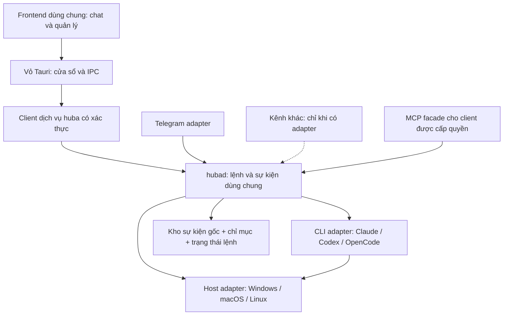

# Thiết kế huba desktop — giao diện, luồng và kiến trúc đa nền tảng

Ngày: 15/11/2026. Trạng thái: **đề xuất để xem xét, chưa triển khai sản phẩm**.

Yêu cầu: chat trực tiếp trên PC; có trang quản lý; nối Telegram và có đường mở rộng kênh; đóng gói cài được; thiết kế trước khi viết sản phẩm; sửa ít mã nhất khi chạy Windows, macOS, Linux. Bản mẫu đi kèm: [ui/index.html](ui/index.html). Dữ liệu trong bản mẫu đều là minh họa.

## 1. Quyết định kiến trúc đề xuất

**Một frontend TypeScript dùng chung trong Tauri 2; tái sử dụng lõi Rust của huba; tách adapter hệ điều hành khỏi adapter CLI và adapter kênh.** Không duy trì ba ứng dụng riêng. React + Vite là lựa chọn mặc định đề xuất cho frontend; không bắt buộc framework đối với lõi hay giao thức.

| Thành phần | Dùng chung | Điểm khác nhau cần giữ nhỏ |
|---|---|---|
| Chat, bảng, biểu mẫu, menu, tìm kiếm, trạng thái | Toàn bộ frontend | Kiểm WebKit/WebView2, font và phím tắt bằng capability; không rẽ nhánh nghiệp vụ theo OS |
| Phiên, lệnh, kiểm nhận, cấu hình, nhật ký, kết nối kênh | Rust application service | Không có điều kiện OS trong nghiệp vụ |
| Đọc nội dung CLI | Một adapter cho mỗi Claude/Codex/OpenCode | Schema và phiên bản CLI; lấy vị trí dữ liệu qua dịch vụ đường dẫn |
| Điều khiển tiến trình và terminal | Interface Host chung | macOS Terminal/Automation; Linux tmux; Windows console/terminal |
| Cửa sổ, chọn tệp/thư mục, clipboard, thông báo | Plugin/API Tauri | Adapter nhỏ nếu plugin không đủ; chỉ native shell gọi API OS |
| Lưu bí mật | SecretStore chung | Giai đoạn đầu giữ nguồn env/huba.env đang có; ACL/quyền riêng theo OS. Keychain/Credential Manager/Secret Service là mở rộng có migration riêng |
| Dịch vụ nền và bộ cài | Cùng manifest phiên bản và quy trình kiểm | launchd, systemd --user, Windows scheduler/service theo bản cài đã hỗ trợ |
| Telegram; kênh tương lai | Một adapter cho mỗi kênh | Xác thực, nhận/gửi, giới hạn nội dung; không sao chép xử lý phiên |

Tauri phù hợp vì huba đã là Rust và có thể tái dùng lõi, không thêm một backend JavaScript thứ hai. Tauri vẫn có khác biệt WebView và phụ thuộc native: Linux cần GTK/WebKit tương thích, Windows cần WebView2, macOS cần ký/notarization khi phân phối. Không gọi đây là “không cần kiểm trên ba hệ”. Electron là phương án thay thế nếu thử nghiệm WebView cho thấy lỗi tương thích không thể giải quyết hợp lý; chưa chọn hai vỏ cùng lúc.

### Ưu tiên hai CLI theo trao đổi tiếp của chủ máy (15/11)

Hướng đề xuất cập nhật: **Claude CLI cho luồng Claude; OpenCode cho các provider/model mà nó hỗ trợ và tài khoản có quyền sử dụng**. Mỗi CLI có một plugin/collector mỏng, chuyển sự kiện sang cùng contract của huba. Chưa cần thêm một adapter chỉ vì thêm một model/provider. Codex đang có trong huba là tích hợp sẵn có; thiết kế này chưa ra lệnh xoá hoặc chuyển tài khoản đó sang nguồn khác.

Hai CLI giúp giảm số tích hợp phải duy trì, không tự chứng minh “phủ mọi model” hay “nạp phiên rẻ nhất”. Phải đối chiếu provider, loại xác thực/API/thuê bao, model ID và tính năng thực; không giả định một gói thuê bao dùng được qua mọi CLI. Chi phí mã tích hợp, token đầu vào và tiền/hạn mức nhà cung cấp là ba phép đo riêng.

Plugin thu/chuẩn hoá dữ liệu chạy ở phía chương trình, không gọi thêm model để trích xuất hoặc tóm tắt mặc định. UI và MCP đọc kho sự kiện bằng cursor; không bơm lại toàn bộ nhật ký vào prompt và không đưa tool/schema quản trị UI cho model khi không cần. Giữ đủ luật/MCP bắt buộc đã có, tránh nạp trùng; công cụ tùy chọn chỉ bật khi cần và theo quyền. Plugin không bảo đảm lấy đủ payload model nếu CLI không xuất nguồn đó.

Trước khi kết luận tiết kiệm: cùng một việc, cùng model/provider khi so được, cùng quyền/luật/tools cần thiết; đo token đầu vào, cache read/write theo số provider thực báo, quota/giá thực và thời gian mở/khôi phục phiên. Tách lượt lạnh và lượt dùng lại; thiếu số cache thì ghi “chưa đo”, không tự coi là 0. Chưa thực hiện phép so này trong phiên thiết kế.



Frontend gọi cùng một tập thao tác: `listSessions`, `readConversation`, `sendMessage`, `answerQuestion`, `interruptTurn`, `closeSession`, `listAccounts`, `saveAccount`, `checkChannel`, `saveSettings`. Đây là **hợp đồng dự kiến**, chưa phải API đang có. Frontend không gọi shell, không đọc DB CLI và không dựng chuỗi lệnh theo hệ điều hành.

Ứng dụng và Telegram dùng cùng hubad, cùng hàng lệnh và kho sự kiện. Tauri không khởi động thêm một Telegram poller. Khi đóng cửa sổ, hỏi lựa chọn đóng cửa sổ hoặc thoát cả dịch vụ; mặc định đóng cửa sổ vẫn để dịch vụ và phiên chạy. Việc tắt dịch vụ phải mô tả ảnh hưởng thật, không mặc định đồng nghĩa đóng các phiên CLI.

Transport nội bộ đề xuất: Unix domain socket trong runtime directory riêng của user trên macOS/Linux; named pipe có ACL của SID người dùng trên Windows. Core kiểm peer identity bằng OS, không tin `principal` client tự khai. Native shell giữ credential pairing ngẫu nhiên riêng của app instance cho scopes đã cấp; frontend chỉ gọi IPC giới hạn, không giữ credential này trong DOM/localStorage. OS identity xác nhận user, pairing xác nhận client đã được cấp quyền; chúng không bảo vệ khỏi mã độc đã chiếm toàn bộ tài khoản OS. MCP facade kiểm cùng scopes tại core, không suy quyền quản trị từ việc đọc được địa chỉ endpoint. Không mở HTTP ra LAN. Transport là adapter, contract nghiệp vụ giữ nguyên; cần spike APIs/permission trên ba OS trước khi triển khai.

## 2. MCP và “input/output gốc”

MCP là mặt giao tiếp truy xuất/điều khiển dịch vụ, **không tự động là bộ thu toàn bộ lưu lượng model**. MCP hiện được gắn vào huba cho công cụ; không có bằng chứng nó quan sát toàn bộ input/output.

| Mức nội dung | Nguồn phải thu | Điều có thể khẳng định |
|---|---|---|
| Người dùng đã soạn | UI/Telegram/terminal nơi nhập | “Đã soạn/đã nhận tại huba”; chưa có nghĩa CLI nhận |
| Hội thoại đã được CLI ghi | Nhật ký/sự kiện chính thức của CLI | Nguyên bản **theo nguồn CLI**; phải giữ role, block, ID, tool call/result, tệp và metadata nguồn |
| Request/response thực gửi tới model | Điểm quan sát request/response được CLI/SDK hỗ trợ | Chỉ có khi adapter chứng minh lấy được; transcript không thay thế mức này |
| Nội dung đang hiện trên terminal | Bản chụp/PTY | Nguồn màn hình; không gắn nhãn nhật ký gốc hay payload model |
| Phần nhà cung cấp không xuất ra | Không có nguồn | Hiện “nguồn không cung cấp”; không suy diễn thinking hoặc prompt bị ẩn |

**Chưa chốt:** chủ máy đang được hỏi cần hội thoại gốc hay cả payload model. Kiến trúc giữ hai nguồn riêng; không hứa payload model khi chưa chứng minh trên CLI cụ thể. Không đổi từ tài khoản thuê bao CLI sang gọi API trả phí chỉ để thu payload.

Luồng thu: `CLI event/journal → collector → raw store → projection dùng chung → desktop/Telegram/MCP`. MCP gọi dịch vụ đọc cùng kho; không nhờ model tự gọi tool “ghi lại lời tôi”, vì có thể thiếu lượt, mất tool, mất output cuối hoặc bị sửa nội dung.

Quy tắc dữ liệu:

1. Giữ bản ghi nguồn nguyên vẹn trước khi tạo nội dung hiển thị. Nếu nguồn có byte offset thì lưu file identity, thế hệ tệp, khoảng byte; nguồn DB dùng bảng/khóa/revision. Không dùng timestamp làm ID duy nhất.
2. Raw record có content hash, session/account/CLI version, source kind, observed time, source time nếu có, correlation ID khi nguồn cung cấp, và trạng thái đầy đủ. Hash chứng minh bản lưu không đổi, không chứng minh nguồn đã cung cấp đủ mọi thứ.
3. Hiển thị là projection; cắt preview không làm mất raw. “Xem bản gốc” mở đúng bản ghi tương ứng, chỉ rõ nguồn, độ đầy đủ, thời điểm. Các chunk streaming và bản cuối được liên kết để không nhân đôi câu trả lời.
4. Không ghép user message với assistant/tool chỉ bằng độ gần thời gian. Nếu nguồn không có ID để ghép chắc chắn, giữ liên hệ chưa xác định.
5. Ảnh/tệp giữ manifest và nội dung hoặc tham chiếu còn kiểm được; nguồn chỉ có đường dẫn thì ghi “chỉ có tham chiếu”, không nhận đã thu đủ tệp.
6. Chưa parse được record thì giữ raw + lỗi parser. Không chuyển thành hội thoại rỗng. Rotation/truncate/resume/subagent có cursor và quan hệ riêng.
7. Không chủ động thêm bí mật cấu hình/xác thực của huba hoặc header transport vào record hội thoại. Nếu chính nguồn CLI đã chứa bí mật (ví dụ tool in nội dung tệp env), không thể vừa giữ nguyên byte vừa hứa bản lưu không có bí mật. Bản raw đó được đánh dấu nhạy cảm và giữ trong vùng lưu riêng chỉ chủ máy có quyền; không đưa vào log chẩn đoán hay xuất/chuyển kênh tự động. Chủ máy vẫn được xem bản gốc theo quyền. Bản chia sẻ đã lọc, nếu người dùng yêu cầu, là derivative có nhãn và liên kết tới raw; không gọi derivative là nguyên bản. Thời hạn lưu, quyền đọc/xuất và audit cấu hình riêng.

MCP facade dự kiến cung cấp các resource hội thoại/raw và các tool theo quyền, gồm phân trang bằng cursor. Dùng khả năng subscribe khi cả server và client hỗ trợ; có đọc tiếp bằng cursor làm phương án chung. MCP client là UI/dịch vụ được cấp quyền khi cần, không bắt mỗi lần vẽ chat phải gọi model. Desktop có thể dùng IPC trực tiếp đến cùng service để giảm lớp chuyển tiếp; semantics và event IDs phải như MCP.

## 3. Khung giao diện dùng chung

Header chạy toàn chiều ngang: trái logo + “huba”; giữa tìm nhanh phiên/dự án; phải trạng thái dịch vụ, thông báo và **Chủ máy**. “Chủ máy” là danh tính điều khiển ứng dụng trên OS này, khác tài khoản model. Không tạo đăng nhập cloud nếu sản phẩm chưa có dịch vụ cloud.

Menu trái có hàng đầu đóng/mở menu; thu gọn vẫn còn icon; màn hẹp chuyển thanh icon. Header không nhảy khi thu menu. Các mục: **Chat · Phiên · Tài khoản & model · Kết nối · Dự án · Hoạt động · Cài đặt**. Phiên bản/cập nhật nằm trong Cài đặt.

Màu nền sáng trung tính, một màu nhấn xanh; trạng thái kèm chữ và icon, không chỉ màu. Chủ đề theo hệ điều hành hoặc người dùng. Nội dung chat có độ rộng đọc được, hỗ trợ Unicode, Markdown an toàn, code copy; không chạy HTML/JS từ model. Bảng có STT xuyên trang, nền xen kẽ, tìm toàn bộ tập và phân trang. Bàn phím có focus rõ; Ctrl/Cmd+Enter gửi, Enter xuống dòng, tùy chọn đổi trong cài đặt.

### Màn và hành vi

| Màn | Nội dung chính | Thao tác và kết quả |
|---|---|---|
| Chat | Danh sách phiên theo dự án, timeline, ô nhập, ngăn chi tiết | Chọn phiên; gửi; lựa chọn đang chờ; mở terminal; xem raw; ngắt lượt; bàn giao/đóng qua menu rõ nghĩa |
| Phiên | Tìm/lọc theo dự án, CLI, account, trạng thái; tổng theo tập lọc | Mở phiên, vào chat, mở terminal, xem subagent; phiên kết thúc chỉ xem lịch sử |
| Tài khoản & model | CLI/account, đăng nhập, model cấu hình, quota có thời điểm | Thêm/sửa/khoá, đăng nhập, kiểm CLI, đồng bộ cấu hình; khoá không xoá lịch sử |
| Kết nối | Desktop nội bộ, Telegram, MCP; trạng thái từng chiều | Wizard Telegram; kiểm kết nối; theo dõi phạm vi thông báo; quyền client MCP; kênh chưa có adapter hiện “chưa hỗ trợ” |
| Dự án | Workspace/folder thực, phiên liên quan, mặc định tài khoản/model | Chọn thư mục native, kiểm quyền đọc/ghi và luật; lưu mặc định cho phiên mới |
| Hoạt động | Lệnh, thay đổi cấu hình, lỗi, kết nối; actor/nguồn/thời gian/đích | Lọc/tìm, mở chi tiết, xuất chẩn đoán đã loại bí mật huba; không đổ toàn bộ raw vào log |
| Cài đặt | Giao diện; phím; nền; lưu trữ; thông báo; quyền; bản cài | Xem trước thay đổi, lưu có version/audit; báo rõ mục áp dụng ngay, cho phiên mới hoặc cần restart |

Chat mở ra **phiên CLI thật**. Mỗi tab giữ session ID riêng; chọn phiên desktop không âm thầm đổi focus Telegram. Một message ghi nguồn Desktop/Telegram/Terminal nếu xác minh được; nguồn không biết hiện “CLI”, không đoán người gửi.

Ngăn phải Chat có ba tab: **Phiên / Nội dung gốc / Hoạt động**. Nội dung gốc hiển thị record đang chọn; payload model là mục riêng chỉ xuất hiện khả dụng khi nguồn hỗ trợ. UI luôn phân biệt “bản ghi CLI nguyên vẹn” và “request model”.

### Trạng thái bắt buộc

| Bề mặt | Bình thường | Rỗng/chưa cấu hình | Lỗi/chưa đo được |
|---|---|---|---|
| Danh sách phiên | Trạng thái mới nhất + mốc đọc | “Chưa có phiên”, CTA Mở phiên | Giữ ảnh trước + “Dữ liệu cũ”; không báo 0 phiên khi probe lỗi |
| Chat | Nội dung + đang tạo/hoàn thành | “Bắt đầu hội thoại” | Draft còn nguyên; nêu đã gửi được tới bước nào; không tự gửi lại khi kết quả mơ hồ |
| Câu hỏi | Lựa chọn từ nguồn + nút xác nhận | Không có hộp hỏi | Hộp hỏi đã đổi/phiên kết thúc: yêu cầu làm mới, không bấm lựa chọn cũ |
| Raw | Bản ghi nguồn + provenance | Nguồn chưa cung cấp | Parse lỗi vẫn xem được raw; màn hình không thay thế raw |
| Kênh | Hướng nhận/gửi + mốc kiểm | CTA Kết nối | Sai secret, sai owner, xung đột poller, mất mạng là lỗi riêng |
| Cài đặt | Giá trị hiện tại + revision | Mặc định an toàn được ghi rõ | Xung đột revision thì so diff/nạp lại; không ghi đè im lặng |

## 4. Luồng xử lý

### 4.1 Cài mới và mở lần đầu

`Cài gói → mở app → nhận diện hubad hiện có → kiểm phiên bản/giao thức → dùng bản tương thích hoặc hướng dẫn cập nhật → chọn workspace → thêm/đăng nhập account → mở phiên → chat`.

Telegram là tùy chọn, không cản chat local. Máy đã cài giữ config, DB, secret và CLI profile. Không chép cấu hình riêng của máy dựng vào gói. Thiếu CLI hay quyền OS phải hiện đúng bước cần xử lý. Đăng nhập tương tác giữ URL/mã gắn đúng account và lần login; hết hạn báo riêng. Không cho UI sửa hàng rào bảo mật để “sửa kết nối”.

### 4.2 Gửi và nhận một lượt chat

```mermaid
sequenceDiagram
  actor Owner as Chủ máy
  participant UI as Desktop hoặc Telegram
  participant Core as huba service
  participant CLI as CLI adapter
  participant Store as Kho sự kiện
  Owner->>UI: Gửi tới phiên đã chọn
  UI->>Core: command ID + session ID + nội dung
  Core->>Store: Ghi ý định, nguồn và trạng thái nhận
  Core->>CLI: Kiểm đúng phiên/cửa sổ; gửi có kiểm nhận
  CLI-->>Core: CLI nhận / còn trong ô / chưa xác định / lỗi
  Core->>Store: Ghi kết quả giao
  Core-->>UI: Trạng thái đúng mức đã chứng minh
  CLI->>Store: Collector ghi input/output/tool từ nguồn
  Store-->>Core: Sự kiện mới + cursor
  Core-->>UI: Timeline cập nhật theo cursor
```

Trạng thái lệnh: `đã nhận tại huba → đang chuyển → CLI đã nhận → đang xử lý → hoàn thành`, hoặc `còn trong ô / không gửi được / chưa xác định`. “Hoàn thành” cần bằng chứng kết thúc lượt, không dùng HTTP 200 hay code 0 của lệnh khởi chạy.

Khóa gửi theo session, không khóa cả ứng dụng. Command ID chống gửi trùng giữa retry của cùng yêu cầu. Đã giao mà mất ACK thì truy hồi trạng thái bằng ID và bằng chứng nguồn; không tự gõ lại. CLI không hỗ trợ bảo đảm exactly-once thì giữ “chưa xác định” và cho chủ máy xử lý. Tin mới khi phiên đang chạy: chỉ cho xếp hàng/ngắt nếu adapter hỗ trợ và đã đo; nếu chưa, giữ draft, mô tả giới hạn.

### 4.3 Mở phiên

`Mở phiên → chọn dự án → chọn tự động hoặc account → model/effort theo account → nhập việc tùy chọn → xem tóm tắt → kiểm luật/MCP/quyền → mở terminal thật → đợi nhận diện session ID → vào chat`.

Mỗi bước có lỗi riêng. Cửa sổ mở được chưa phải phiên sẵn sàng. Capability chưa có thì nút không thực thi và giải thích lý do; không chạy ngầm một kiểu phiên khác.

### 4.4 Câu hỏi, ngắt, đóng, bàn giao

- Câu hỏi nhiều phần giữ question ID/revision, chọn đủ rồi xác nhận một lần; đọc lại nguồn sau thao tác. Không tự bịa options bằng nội dung rút gọn.
- **Ngắt lượt** dừng tác vụ hiện tại, giữ phiên. **Đóng phiên** kết thúc phiên và xác nhận đúng phiên. Hai nút có nhãn khác nhau.
- **Bàn giao** xem mục tiêu và kết quả trước chuyển; chỉ hỗ trợ CLI có cơ chế đã đo. Chưa có fork chỉ đọc trên CLI thì ghi khả năng chưa hỗ trợ, không giả lập bằng gửi prompt vào phiên chính.

### 4.5 Telegram

`Kết nối → Telegram → nhập token → kiểm danh tính bot → nhắn bot từ điện thoại → xác minh đúng chat/chủ sở hữu → chọn thông báo và phiên theo dõi → xem tóm tắt → lưu → áp dụng cấu hình → kiểm nhận/gửi hai chiều`.

Bot token không hiện lại sau lưu. Wizard không chạy `getUpdates` thứ hai song song với daemon: kiểm chat qua cùng collector của daemon. `getMe` thành công chỉ chứng minh token hợp lệ, chưa chứng minh nhận/gửi hai chiều. Đổi bot/chat phải xác nhận đích mới và giữ đường quay lại khi lỗi; gửi tin kiểm tra chỉ sau khi chủ máy chủ động bấm. Ngắt kênh không đóng phiên local. Telegram và desktop cùng thấy một sự kiện, không cùng thực thi lại lệnh.

### 4.6 Quản lý tài khoản/model và cấu hình động

`Tài khoản → thêm/sửa → chọn loại CLI → trường phù hợp → kiểm schema → lưu revision + audit → đăng nhập → kiểm kết quả thật → sẵn sàng cho phiên mới`.

Tái dùng application service của trang accounts, không nhúng một website có logic lưu độc lập làm sản phẩm cuối. Catalog model và mặc định account nằm trong dữ liệu; model do CLI chưa xác minh được hiện nhãn tương ứng. Thay model mặc định áp dụng phiên mới; không tự đổi model của phiên đang chạy nếu CLI không có thao tác đó. Quota luôn có nguồn, thời điểm đo; không biết không thành 0%. Quyền đổi cấu hình nhạy cảm thuộc chủ máy/quản trị; mọi client phải được core kiểm quyền.

### 4.7 Mất kết nối và phục hồi

`Mất IPC/daemon → giữ draft và nội dung đã đọc → đánh dấu dữ liệu cũ → reconnect có backoff → đối chiếu command ID đang treo → đọc tiếp từ cursor → chỉ tiếp tục thao tác sau kiểm phiên và quyền`.

Restart app không mặc định restart CLI. Hubad chỉ một writer vận hành trên DB; migration có backup/transaction. Client/core khác version phải thương lượng giao thức và capabilities; không đoán tương thích.

## 5. Hợp đồng chung và cách giảm sửa mã

| Hợp đồng | Vai trò | Khi thêm OS | Khi thêm CLI | Khi thêm kênh |
|---|---|---|---|---|
| `ConversationSource` | Đọc raw/event, cursor, capability theo phiên bản | Tái dùng parser; thêm cách tìm nguồn nếu cần | Viết adapter nguồn | Giữ nguyên |
| `SessionDriver` | Mở, gửi, kiểm nhận, ngắt, đóng theo semantics CLI | Dùng Host mới | Bổ sung driver CLI | Giữ nguyên |
| `Host` | Tiến trình, terminal, đường dẫn, quyền, thông báo | Viết adapter OS | Tái dùng | Giữ nguyên |
| `Channel` | Nhận ý định, xác thực principal, gửi sự kiện | Giữ nguyên | Giữ nguyên | Viết adapter kênh |
| `ApplicationService` | Quyền, thứ tự, idempotency, trạng thái, audit | Giữ nguyên | Dùng capability | Giữ nguyên |

Capabilities ở mức OS + CLI version + kiểu phiên và đã kiểm được, ví dụ: `conversation_read`, `raw_cli_record`, `model_payload`, `send_verified`, `interrupt`, `close`, `readonly_fork`, `attachments`, `question_answer`. Giao diện render theo capability trả về; không `if Windows` trong màn chat và không giả định mọi CLI ngang nhau.

Schema event dự kiến: `schema_version, event_id, source_event_id?, session_id, parent_session_id?, turn_id?, command_id?, kind, role?, content_blocks, source_ref, completeness, source_time?, observed_time`. Raw nằm riêng, được tham chiếu; không log raw trong lỗi. Source record chưa có role/turn ID thì giữ null và lý do.

Ba quy tắc tổ chức mã: (1) một handler nghiệp vụ cho desktop/Telegram/MCP; (2) frontend chỉ dùng generated types + client SDK; (3) native shell chỉ window/IPC, không giữ sổ phiên hoặc logic model. Không viết lại tất cả lõi: tách từng seam, giữ regression và route cũ hoạt động trong quá trình chuyển.

## 6. Hiện trạng đã đọc và khoảng thiếu

Mốc khảo sát HEAD `04d74e2`; các vị trí dưới đây là số dòng lúc khảo sát, chưa phải sơ đồ phụ thuộc chạy được.

| Mã hiện tại | Có thể tái dùng | Khoảng thiếu cần xử lý |
|---|---|---|
| `rust/src/accounts_page.rs:150`, `:177` | PageState, router quản lý account/login/model | Tách service khỏi HTML để frontend chung gọi; giữ semantics |
| `rust/src/localserver.rs:33`, `:41`, `:64` | Loopback, request/response | Vé hiện timestamp+pointer và HTTP không giới hạn body; không dùng nguyên dạng cho app sống lâu |
| `rust/src/sessions.rs:5834`, `:7182` | Snapshot, nguồn transcript Claude | Stream hiện có giới hạn và đọc Claude schema; chưa phải kho raw nhiều CLI |
| `rust/src/sessions.rs:6961`, `:7028` | Parser stream hiện tại | `trim`/`truncate` và bỏ record không hiểu; không thể gọi output là nguyên bản |
| `rust/src/codex_sessions.rs:110`, `:125` | Đọc assistant/user từ rollout | Chưa có collector bảo toàn mọi block/tool/attachment/request model |
| `rust/src/opencode.rs:104`, `:154` | Đọc DB read-only và lượt đầu | Cần đối chiếu schema/version và đủ nội dung từng loại block |
| `rust/src/pipeline.rs:8242`, `:11285` | Kiểm target + gửi + kiểm nhật ký | Hàm private; cần service gửi dùng chung, giữ phân biệt chưa xác định |
| `rust/src/setup.rs:202` | Lưu secret vào huba.env | UI mới cần validation newline/env và quyền trước ghi; không trả secret qua HTTP/MCP |
| `rust/src/accounts_page.rs:309` | Luồng lưu Telegram hiện có | Không bê nguyên hành vi restart vào wizard; cần apply có trạng thái và không poll đôi |
| `rust/src/bin/browser_mcp.rs:73`, `:89` | Ví dụ MCP tools transport | Đây là MCP lái browser, không phải bộ thu hội thoại |
| `scripts/dong-goi-linux.sh:18`, `:93` | Nội dung bundle Linux hiện có | Cross-build/cờ tar hiện thiên Mac; cần bước native đã kiểm |

MCP `project-agent` hiện gắn qua `rust/src/accounts.rs:171` cho công cụ dự án; không phải bằng chứng trích toàn bộ input/output. Không sửa kho codetrail trong phiên thiết kế huba/ui.

## 7. Đóng gói và nghiệm thu trước khi tuyên bố chạy được

Một pipeline, build matrix riêng trên OS thật. Đề xuất Linux `.deb` trước, Windows installer theo Tauri, macOS `.app`/`.dmg`; bổ sung ARM khi có máy nghiệm thu. Gói mang frontend + Rust binary đồng phiên bản, MCP/cổng luật và runtime dependency theo manifest. Không hứa AppImage hay MSI/MSIX trước khi chọn kênh phân phối và thử dependency.

Mỗi target phải cài mới → mở từ launcher → chọn workspace → login account → tạo phiên → gửi và nhận → đóng/mở lại app → dùng Telegram khi app đóng → cập nhật → gỡ app có lựa chọn giữ dữ liệu. Không coi cross-compile là chạy trên OS thật. Gói ký và manifest checksum; update có rollback và kiểm migration. Không tự tải/chạy bản cập nhật chưa xác minh.

Nghiệm thu contract dùng cùng bộ ca cho từng adapter. Ca âm bắt buộc gồm đọc nguồn lỗi, UTF-8/đa dòng/nội dung dài, tool call-result, record trùng, chunk-cuối, file rotation, cursor cũ, session đổi terminal, mất ACK, double-click, restart giữa gửi, bot sai chat, token thiếu, xung đột cấu hình. Thu một raw record thì đối chiếu byte/hash với nguồn; kiểm đủ/thiếu từng loại block theo mẫu số. Hash khớp một record không chứng minh đã thu toàn bộ giao tiếp.

E2E đi từ UI thật, mọi menu/nút, nhiều câu hỏi, empty/loading/error/offline/hover, console không lỗi; ảnh trên ba WebView thật để so. Bản mẫu chỉ nghiệm thu bố cục và luồng minh họa. Chưa có dependency map máy đọc được trong lượt khảo sát: phải bổ sung map trích từ code/traces khi triển khai; không coi sơ đồ thiết kế ở đây là map đã đo.

## 8. Thứ tự triển khai sau thiết kế

1. Chốt mức input/output cần lấy; spike nguồn trên mỗi CLI, công bố capability và phần chưa đo. Thử vỏ Tauri build/chạy trên ba OS trước khi đầu tư nhiều màn.
2. Khóa contract raw/event/command; tách application service khỏi pipeline Telegram, giữ kiểm nhận và hàng rào hiện có.
3. Chat một phiên thật, đầy đủ lỗi và phục hồi; đối chiếu bản gốc trước mở rộng màn.
4. Quản lý account/model/dự án/cấu hình/hoạt động; Telegram dùng cùng service và kiểm chéo desktop ↔ điện thoại.
5. Bộ cài/update ký theo target, smoke trên máy sạch; ghi rõ target nào chưa nghiệm thu.

Điểm cần chủ máy chốt hiện tại: mức “gốc” ở §2. Tauri là đề xuất kiến trúc để giảm sửa mã theo OS; lựa chọn cuối phụ thuộc spike tương thích. Phần còn lại là mặc định thiết kế có thể xem và chỉnh qua bản mẫu, chưa phải sản phẩm đã cài.
